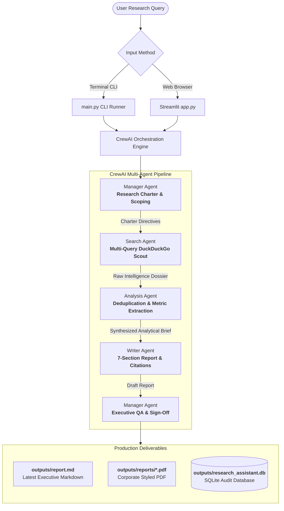

# 🔬 Autonomous Multi-Agent Research Assistant

[](https://www.python.org/)
[](https://crewai.com)
[](https://ai.google.dev/)
[](https://duckduckgo.com)
[](https://streamlit.io)
[](LICENSE)

> A production-ready, autonomous multi-agent research intelligence system. Multiple specialized AI agents collaborate sequentially to investigate any topic, query real-time web sources, eliminate noise, extract verifiable metrics, and author publication-grade executive reports in **Markdown** and **PDF** with structured citations.

---

## 📑 Table of Contents

- [Overview & Value Proposition](#-overview--value-proposition)
- [How It Works: Conceptual Foundation](#-how-it-works-conceptual-foundation)
- [Step-by-Step Work Process & Agent Pipeline](#-step-by-step-work-process--agent-pipeline)
- [Visual System Architecture](#-visual-system-architecture)
- [Project Directory Structure](#-project-directory-structure)
- [Tech Stack & Prerequisites](#-tech-stack--prerequisites)
- [Installation & Quickstart](#-installation--quickstart)
- [Execution Modes](#-execution-modes)
  - [1. Streamlit Web Application (GUI)](#1-streamlit-web-application-gui)
  - [2. Interactive Terminal CLI](#2-interactive-terminal-cli)
  - [3. Scriptable CLI with Direct Arguments](#3-scriptable-cli-with-direct-arguments)
  - [4. Inspecting SQLite Database Archives](#4-inspecting-sqlite-database-archives)
- [Report Structure & Citation Schema](#-report-structure--citation-schema)
- [Bonus Production Features](#-bonus-production-features)
- [Troubleshooting & FAQs](#-troubleshooting--faqs)

---

## 🌟 Overview & Value Proposition

Traditional single-prompt LLM research suffers from three critical flaws:
1. **Knowledge Cutoffs & Hallucinations:** Large models lack real-time market facts without web search.
2. **Surface-Level Summarization:** A single prompt attempts to search, filter, analyze, and format simultaneously, leading to generic outputs.
3. **Absence of Source Attribution:** Assertions lack verifiable citation links and statistics.

The **Multi-Agent Research Assistant** solves this through **specialized role delegation** orchestrated by **CrewAI**. By breaking research down into distinct, sequential phases with specialized agents, the system delivers boardroom-ready intelligence dossiers on any topic—from *AI Agents in Software Engineering* to *Serverless Cloud Computing* and *Startup Valuations*.

---

## 🧠 How It Works: Conceptual Foundation

The platform mimics the operational workflow of a tier-1 strategic consulting firm:

```
┌─────────────────┐       ┌─────────────────┐       ┌─────────────────┐       ┌─────────────────┐
│ [1] SCOPE       │       │ [2] DISCOVER    │       │ [3] SYNTHESIZE  │       │ [4] DELIVER     │
│ Manager Agent   │ ────> │ Search Agent    │ ────> │ Analysis Agent  │ ────> │ Writer Agent    │
│ Frames Charter  │       │ Scours Web/DDG  │       │ Extracts Metrics│       │ Formats & Cites │
└─────────────────┘       └─────────────────┘       └─────────────────┘       └─────────────────┘
                                                                                       │
                                                                                       ▼
                                                                           ┌───────────────────────┐
                                                                           │ [5] AUDIT & PERSIST   │
                                                                           │ • outputs/report.md   │
                                                                           │ • outputs/*.pdf       │
                                                                           │ • SQLite Database     │
                                                                           └───────────────────────┘
```

1. **Manager Agent** receives the inquiry and formulates the strategic research charter.
2. **Search Agent** executes multiple queries against DuckDuckGo, gathering live data, articles, and URLs.
3. **Analysis Agent** cross-checks findings, extracts quantitative data points, eliminates marketing fluff, and creates an indexed citation map.
4. **Writer Agent** drafts an exhaustive 7-section Markdown report in the requested language.
5. **Manager Agent (QA)** performs an executive review, ensuring complete citations and high rigor.
6. **Pipeline Exporters** generate a corporate-styled PDF and persist the complete record in an SQLite database.

---

## 🔄 Step-by-Step Work Process & Agent Pipeline

### Step 1: Research Charter & Scoping
* **Agent:** `Manager Agent (Research Director)`
* **Task:** `create_scoping_task`
* **Inputs:** User topic string (e.g., *"Impact of AI Agents in software engineering jobs"*).
* **Process:**
  - Decomposes the topic into 4–5 strategic inquiry vectors: technological taxonomy, adoption statistics, high-impact use cases, bottlenecks/risks, and a 1–5 year industry outlook.
  - Generates clear investigative instructions for the downstream agents.
* **Output:** A formal Research Charter defining exact investigative goals.

---

### Step 2: Information Retrieval & Multi-Angle Search
* **Agent:** `Search Agent (Lead Web Research Scout)`
* **Task:** `create_search_task`
* **Tool Used:** `DuckDuckGoSearchTool` with exponential backoff retry.
* **Process:**
  - Formulates 3–4 targeted, distinct search queries:
    1. Core definition, architecture, and current state.
    2. Quantitative adoption statistics, productivity benchmarks, and market numbers.
    3. Real-world case studies and enterprise use cases.
    4. Technical bottlenecks, security concerns, and ethical/governance challenges.
  - Normalizes search responses into structured records with **Title**, **Exact URL**, **Publishing Domain**, and **Factual Snippet**.
* **Output:** A fact-dense raw intelligence dossier with full source attribution.

---

### Step 3: Synthesis, Metric Extraction & Deduplication
* **Agent:** `Analysis Agent (Senior Research Analyst)`
* **Task:** `create_analysis_task`
* **Context:** Dossier from Step 2.
* **Process:**
  - Filters out unsubstantiated marketing hype, clickbait, and duplicate information.
  - Isolates quantifiable data points (percentages, turnaround hours, dollar values, benchmarks).
  - Groups takeaways into core themes: *Market Drivers*, *High-Value Benefits*, *Risks & Bottlenecks*, and *Future Trajectory*.
  - Assigns indexed citation tags `[1]`, `[2]`, `[3]` to each claim and its verified source URL.
* **Output:** A structured analytical briefing with comparative tables and citation mapping.

---

### Step 4: Executive Report Drafting & Citation Formatting
* **Agent:** `Writer Agent (Principal Technical Author)`
* **Task:** `create_writing_task`
* **Context:** Analytical brief from Step 3.
* **Process:**
  - Synthesizes findings into a comprehensive Markdown report adhering strictly to the **7-section schema**.
  - Localizes the prose to the selected target language (e.g., English, Spanish, French, German, Hindi, Japanese).
  - Embeds in-text citation markers `[1]`, `[2]` directly alongside facts.
  - Builds the **References & Sources** Markdown table linking each index to its title, domain, and URL.
* **Output:** The draft Markdown document saved to `outputs/report.md`.

---

### Step 5: Final Executive Review & Sign-Off
* **Agent:** `Manager Agent (Research Director)`
* **Task:** `create_review_task`
* **Context:** Draft report from Step 4.
* **Process:**
  - Validates that all 7 mandatory sections are fully developed without placeholder text.
  - Verifies that all citations `[1]`, `[2]` correspond to the references table.
  - Polishes the narrative flow and ensures an objective, C-suite tone.
* **Output:** The finalized, production-ready research deliverable.

---

### Step 6: Artifact Generation & Persistence
* **Process:**
  - **Primary Markdown:** Saved directly to `outputs/report.md`.
  - **Timestamped Archive:** Saved to `outputs/reports/report_<slug>_<timestamp>.md`.
  - **Corporate PDF Export:** Generated via `utils/pdf_exporter.py` with custom headers, footers, page numbering, and styled tables (`outputs/reports/*.pdf`).
  - **Database Persistence:** Metadata, full markdown, word count, sources count, and timestamps logged to `outputs/research_assistant.db`.

---

## 📊 Visual System Architecture



---

## 🗂️ Project Directory Structure

```
research-assistant/
│
├── agents/                       # Specialized Agent Factory Modules
│   ├── __init__.py               # Exports create_*_agent functions
│   ├── manager.py                # Manager Agent: Scoping & Executive Review
│   ├── search_agent.py           # Search Agent: DuckDuckGo Information Retrieval
│   ├── analysis_agent.py         # Analysis Agent: Deduplication & Metric Extraction
│   └── writer_agent.py           # Writer Agent: Structured Markdown Authoring
│
├── tasks/                        # Task Definitions & Context Chaining
│   ├── __init__.py               # Exports create_*_task functions
│   ├── search_task.py            # Targeted multi-query web search instructions
│   ├── analysis_task.py          # Data filtering, metrics synthesis & citation mapping
│   ├── writing_task.py           # 7-section report authoring with language localization
│   └── manager_task.py           # Charter formulation and final review tasks
│
├── tools/                        # Custom Tool Integrations
│   ├── __init__.py               # Exports DuckDuckGoSearchTool
│   └── search_tool.py            # Resilient DDG Search with exponential backoff
│
├── config/                       # Application Configuration & LLM Factory
│   ├── __init__.py               # Settings package exports
│   └── settings.py               # Pydantic settings, Rich logging & Gemini LLM factory
│
├── utils/                        # Persistence & Export Utilities
│   ├── __init__.py               # Exports db and pdf utilities
│   ├── db.py                     # SQLite database schema, inserts, search, stats
│   └── pdf_exporter.py           # Custom FPDF2 engine with styled tables & headers
│
├── outputs/                      # Generated Deliverables
│   ├── report.md                 # Primary active research report
│   ├── reports/                  # Archived Markdown (.md) and PDF (.pdf) files
│   ├── research_assistant.db     # SQLite persistence database
│   └── research.log              # Production execution log file
│
├── main.py                       # Rich CLI interface with interactive menus
├── app.py                        # Streamlit web GUI dashboard
├── requirements.txt              # Production dependency specifications
├── .env.example                  # Environment variable configuration template
└── README.md                     # Complete system documentation
```

---

## 💻 Tech Stack & Prerequisites

* **Runtime:** Python 3.11+ or 3.12+
* **Agent Framework:** [CrewAI](https://github.com/crewAIInc/crewAI) (v1.15+)
* **LLM Core:** [Google Gemini Flash](https://ai.google.dev/) (`gemini-3.5-flash` / `gemini-3.6-flash` / `gemini-3.8-flash`)
* **Search Engine:** DuckDuckGo Search (`ddgs` / `duckduckgo-search`)
* **Web UI:** [Streamlit](https://streamlit.io/) (v1.40+)
* **PDF Engine:** [FPDF2](https://py-pdf.github.io/fpdf2/) (v2.8+)
* **Terminal UI:** [Rich](https://github.com/Textualize/rich) (v13+)
* **Database:** SQLite3 (standard library)

---

## 🚀 Installation & Quickstart

### 1. Clone the Repository
```bash
git clone https://github.com/your-username/research-assistant.git
cd research-assistant
```

### 2. Create and Activate a Virtual Environment

**Windows (PowerShell):**
```powershell
python -m venv .venv
.\.venv\Scripts\Activate.ps1
```

**macOS / Linux:**
```bash
python3 -m venv .venv
source .venv/bin/activate
```

### 3. Install Required Dependencies
```bash
pip install -r requirements.txt
```

### 4. Configure Environment Variables
Copy `.env.example` to `.env`:
```bash
cp .env.example .env
```
*(On Windows PowerShell: `Copy-Item .env.example .env`)*

Open `.env` and provide your Google Gemini API Key:
```env
# Google Gemini API Key (Get a free key from https://aistudio.google.com/app/apikey)
GEMINI_API_KEY=your_actual_gemini_api_key_here

# Active Gemini Model (gemini/gemini-3.5-flash, gemini/gemini-3.6-flash, gemini/gemini-3.8-flash)
GEMINI_MODEL=gemini/gemini-3.5-flash

# Default Report Language
DEFAULT_LANGUAGE=English

# Logging Level
LOG_LEVEL=INFO
```

---

## 🎮 Execution Modes

### 1. Streamlit Web Application (GUI)

Launch the interactive web dashboard:
```bash
streamlit run app.py
```
Open **[http://localhost:8501](http://localhost:8501)** in your web browser.

#### GUI Features:
* **Sidebar Controls:** Dynamically switch Gemini models (`gemini-3.5-flash`, `gemini-3.8-flash`, etc.), adjust sampling temperature, or select report languages.
* **Topic Presets:** 1-click pills for popular research topics (AI Agents, GenAI, Cloud Computing, WebAssembly, Startups).
* **Live Mission Tracker:** Real-time visibility into the currently active agent.
* **Formatted Preview & Downloads:** Instant rendering with 1-click buttons to download `.md` or `.pdf`.
* **Database Archives Tab:** Browse, filter, inspect, and re-download previously generated reports from SQLite.

---

### 2. Interactive Terminal CLI

Run the interactive terminal interface:
```bash
python main.py
```
Presents a stylized menu powered by **Rich**:
```
+-----------------------------------------------------------------------------+
|  MULTI-AGENT RESEARCH ASSISTANT                                             |
|  Powered by CrewAI, Google Gemini & DuckDuckGo Search                       |
|  Collaborative AI Agents: Manager -> Search -> Analysis -> Writer           |
+-----------------------------------------------------------------------------+

Select a Research Topic or enter your own:
  [1] AI Agents in Software Engineering and Developer Productivity
  [2] Generative AI in Healthcare Diagnostics and Drug Discovery
  [3] Cloud Computing Serverless Architectures & Edge AI 2025-2026
  [4] Full Stack Development with WebAssembly, Rust, and Next.js
  [5] Early-Stage AI Startups: Valuation Multiples & Capital Efficiency
  [0] Enter custom research topic
```

---

### 3. Scriptable CLI with Direct Arguments

Pass arguments directly for automated or batch workflows:

```bash
# Research any topic directly
python main.py --topic "Research the impact of AI Agents in software engineering jobs."

# Multi-language report (e.g., Spanish, French, German, Hindi, Japanese)
python main.py --topic "Generative AI in Healthcare" --language "Spanish"

# Choose a specific Gemini model
python main.py --topic "Cloud Computing Trends" --model "gemini/gemini-3.5-flash"

# Select CrewAI process orchestration mode (sequential or hierarchical)
python main.py --topic "Startups Valuation Multiples" --process "hierarchical"

# Skip PDF export if only Markdown is required
python main.py --topic "AI Agents" --no-pdf
```

---

### 4. Inspecting SQLite Database Archives

To view past research missions stored in SQLite from your terminal:
```bash
python main.py --list-reports
```

Output:
```
                      Archived Research Reports Database                       
+-----------------------------------------------------------------------------+
| ID | Date             | Topic                      | Language | Words | PDF |
|----+------------------+----------------------------+----------+-------+-----|
| 1  | 2026-10-15 13:27 | Impact of AI Agents in     | English  | 1,103 | Yes |
|    |                  | Software Engineering J...  |          |       |     |
+-----------------------------------------------------------------------------+
Total Reports: 1 | Total Words: 1,103
```

---

## 📑 Report Structure & Citation Schema

Every research report generated adheres to a rigorous **7-Section Executive Schema**:

```markdown
# [Compelling, Professional Report Title]
> **Research Topic:** {topic} | **Language:** {language} | **Status:** Production-Ready

## 1. Executive Summary
Concise executive briefing on core thesis, magnitude of impact, and strategic takeaway.

## 2. Market & Technology Overview
Foundational concepts, technology stack taxonomy, and historical/current context.

## 3. Key Findings & Trends
Verified breakthroughs, quantifiable benchmark tables, and in-text citation anchors [1], [2].

## 4. Detailed Analysis
### 4.1 Benefits & High-Value Use Cases
Concrete real-world applications, productivity metrics, and ROI.
### 4.2 Challenges, Bottlenecks & Risk Factors
Technical bottlenecks, security, governance, and organizational hurdles.

## 5. Strategic Recommendations & Future Outlook
1-to-5-year forecast and practical roadmap for practitioners and decision-makers.

## 6. Conclusion
Definitive closing perspective synthesizing the ultimate trajectory.

## 7. Sources & References
| Citation | Source Title | Domain / Organization | URL |
| :---: | :--- | :--- | :--- |
| [1] | Future of AI Agents in Engineering | Gartner | https://... |
```

---

## 🎁 Bonus Production Features

| Feature | Implementation | Description |
| :--- | :--- | :--- |
| 📕 **Corporate PDF Exporter** | `utils/pdf_exporter.py` | Built with `fpdf2`. Converts Markdown into a styled corporate PDF with headers, footers, page numbering, heading borders, and tabular data. |
| 🗄️ **SQLite Persistence** | `utils/db.py` | Full audit trail storing topics, languages, word counts, timestamps, search queries, and full Markdown reports in `outputs/research_assistant.db`. |
| 💻 **Streamlit GUI** | `app.py` | Interactive dashboard featuring model controls, real-time agent status tracking, instant markdown rendering, and past reports search. |
| 🔗 **Citation Standard** | `tasks/writing_task.py` | In-text citation anchors (`[1]`, `[2]`) correlated to a complete Markdown bibliography table with verified links. |
| 🌐 **Multi-Language Support** | `tasks/writing_task.py` | Instructs the writer agent to author the complete report in English, Spanish, French, German, Hindi, Japanese, and more. |
| 🛡️ **Rate-Limit Resilience** | `tools/search_tool.py` | Exponential backoff retry logic to handle rate-limits and network hiccups seamlessly without crashing the crew. |

---

## ❓ Troubleshooting & FAQs

### Q1: `404 NOT_FOUND: This model models/gemini-2.0-flash is no longer available`
* **Resolution:** Google has updated model endpoints. Use `gemini/gemini-3.5-flash`, `gemini/gemini-3.6-flash`, or `gemini/gemini-3.8-flash`. The system includes automatic legacy remapping in `config/settings.py` to upgrade obsolete strings automatically.

### Q2: `GEMINI_API_KEY is missing or invalid!`
* **Resolution:** Ensure you have added your API key to `.env`. You can get a free key at [Google AI Studio](https://aistudio.google.com/app/apikey). You can also enter it interactively when prompted in the terminal or Streamlit sidebar.

### Q3: Unicode encoding issues on Windows PowerShell
* **Resolution:** Set UTF-8 encoding in your PowerShell session:
  ```powershell
  $env:PYTHONIOENCODING = "utf-8"
  [Console]::OutputEncoding = [System.Text.Encoding]::UTF8
  ```

---

## 🤝 Contributing

Contributions are welcome! Please feel free to open issues or submit Pull Requests:
1. Fork the Project
2. Create your Feature Branch (`git checkout -b feature/NewFeature`)
3. Commit your Changes (`git commit -m 'Add NewFeature'`)
4. Push to the Branch (`git push origin feature/NewFeature`)
5. Open a Pull Request

---

## 📄 License

Distributed under the **MIT License**. See `LICENSE` for more information.

---

<!-- <div align="center">
  Built with ❤️ using <b>CrewAI</b>, <b>Google Gemini</b>, and <b>DuckDuckGo</b>
</div> -->
